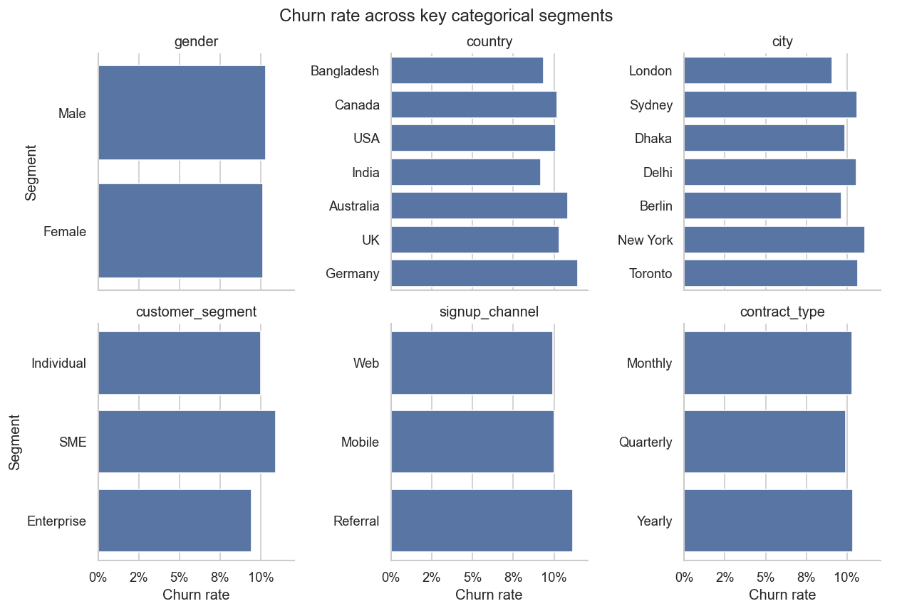
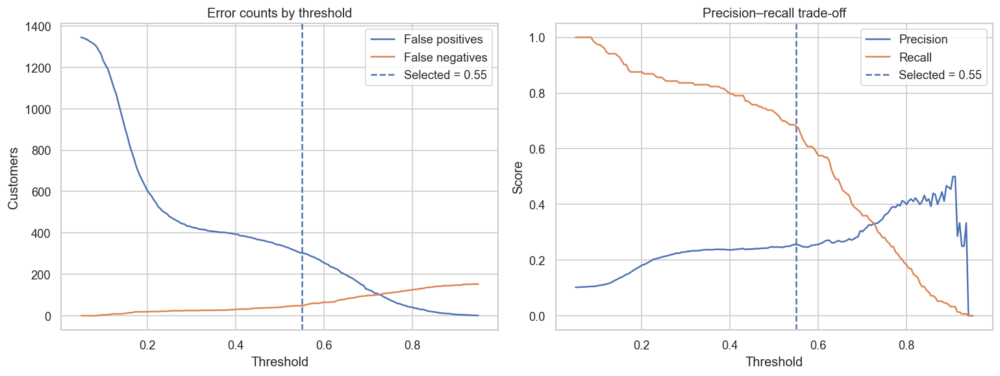
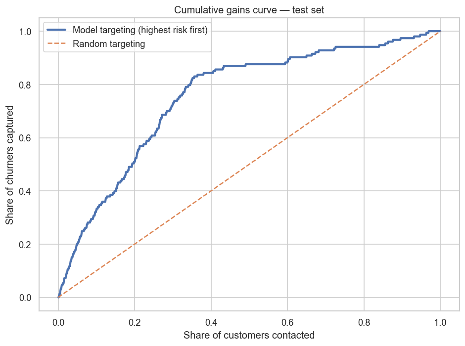
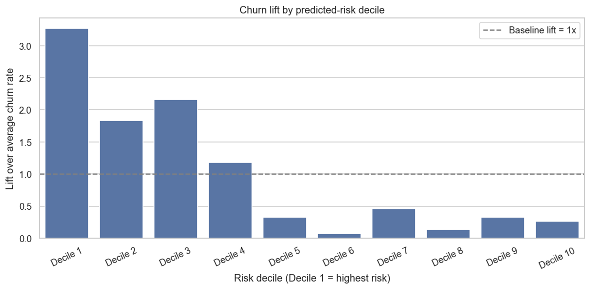
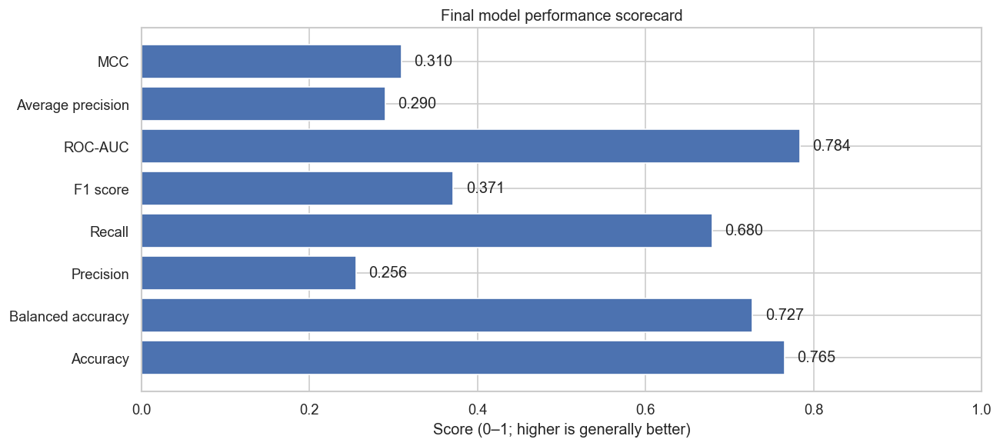
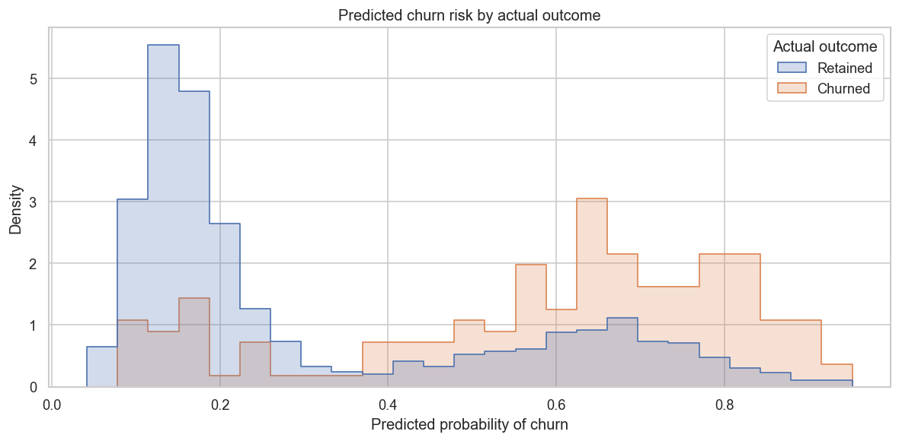

<div align="center">

# ChurnWise AI
### Customer Churn Prediction & Retention Intelligence

**An end-to-end machine-learning and Flask web application — built by Shubhang**

Turn customer behaviour, engagement, billing, and satisfaction signals into churn-risk estimates and actionable retention workflows.


</div>

---

## Overview

**ChurnWise AI** is a customer churn prediction project combining a reproducible Jupyter notebook with a Flask application. It trains and evaluates classification models, selects a decision threshold on validation data, reports held-out test performance, and serves predictions through a web interface and JSON API.

The project is designed as a small retention-intelligence workflow rather than only a model-training exercise:

- Explore customer and churn patterns.
- Compare candidate classification models.
- Evaluate performance with metrics suited to an imbalanced target.
- Estimate churn probability for an individual customer.
- Score a portfolio of customers from a CSV.
- Review risk bands and transparent, rule-based follow-up suggestions.

> **Important:** This is a portfolio and analytical demonstration. Model probabilities are estimates, not guarantees of future customer behaviour.

## Dashboard and analysis gallery

### Customer segment churn rates



This view compares observed churn rates across categorical groups such as gender, country, city, customer segment, signup channel, and contract type. Segment-level differences are descriptive and should not be interpreted as causal effects.

### Threshold selection and error trade-offs



A classification threshold changes the balance between false-positive alerts and missed churners. The threshold used in the final notebook run is **0.55**, selected on the validation set.

### Cumulative gains



The cumulative gains curve shows how many actual churners are captured as the model prioritizes more customers from highest predicted risk to lowest. The dashed diagonal represents random targeting.

### Lift by predicted-risk decile



Decile analysis helps assess whether higher-ranked risk groups contain more churners than the overall customer population. Decile 1 represents the highest predicted risk in this chart.

### Final model scorecard



### Predicted risk by actual outcome



The probability distributions overlap, showing that the model does not perfectly separate retained and churned customers. Use the score to support prioritization and investigation, not as a definitive label.

## Final model results

The following figures are from the notebook's **final held-out test run**, with a decision threshold of **0.55**. The test set contains 1,500 rows.

| Metric | Test result |
|---|---:|
| Accuracy | **0.7653** |
| Balanced accuracy | 0.7274 |
| Churn precision | 0.2555 |
| Churn recall | **0.6797** |
| Churn F1 score | 0.3714 |
| ROC-AUC | 0.7839 |
| Average precision | 0.2900 |
| Matthews correlation coefficient (MCC) | 0.3096 |
| Log loss — lower is better | 0.4748 |
| Brier score — lower is better | 0.1557 |
| Selected decision threshold | 0.55 |

### Confusion matrix at the selected threshold

| Outcome | Count | Meaning |
|---|---:|---|
| True negatives | 1,044 | Retained customers correctly identified |
| False positives | 303 | Retained customers flagged as potential churners |
| False negatives | 49 | Churners not flagged by the model |
| True positives | 104 | Churners correctly identified |

**Interpretation:** At this threshold, the model identifies approximately **68% of actual churners** in the test set, while churn precision is approximately **25.6%**. This means the model captures a useful share of churners, but many flagged customers will not churn. Choose an operating threshold based on campaign capacity, intervention cost, and the relative cost of false positives versus missed churners.

Metrics can change if the dataset, split, random seed, preprocessing, or package versions change. The figures above describe this recorded run, not guaranteed future performance.

## Dataset

**Source:** [Customer Churn Prediction Business Dataset — Kaggle](https://www.kaggle.com/datasets/miadul/customer-churn-prediction-business-dataset/code)

| Dataset detail | Value |
|---|---|
| Records | 10,000 |
| Source columns | 32 |
| Target | `churn` |
| Target meaning | `0` = retained, `1` = churned |
| Observed churn rate | 10.21% |
| Train split | 7,000 rows |
| Validation split | 1,500 rows |
| Test split | 1,500 rows |
| Final selected model | Tuned XGBoost |
| Validation-selected threshold | 0.55 |

The source data contains multiple groups of customer attributes:

- **Engagement:** monthly logins, active days, average session time, feature usage, usage growth, and last-login recency.
- **Commercial:** monthly fee, total revenue, payment failures, discounts, and recent price changes.
- **Customer experience:** support tickets, average resolution time, complaint type, CSAT, escalations, and NPS.
- **Marketing and advocacy:** email open rate, marketing click rate, survey response, and referrals.
- **Customer profile:** age, gender, country, city, customer segment, tenure, signup channel, and contract type.

`customer_id` is an identifier and should not be used as a predictive feature. The model uses the 30 feature columns and excludes the target `churn`.

**Dataset licensing:** Check the current Kaggle page and license before redistributing the raw CSV. If redistribution permission is unclear, do not commit the dataset to a public GitHub repository; provide instructions for obtaining it from the source instead.

## What makes ChurnWise AI distinctive?

The project combines model evaluation with a practical scoring workflow:

1. **Multi-signal modelling** across engagement, commercial, customer-experience, marketing, and profile features.
2. **Imbalance-aware evaluation** using recall, precision, F1, balanced accuracy, ROC-AUC, average precision, MCC, log loss, and Brier score.
3. **Threshold analysis** to make the false-positive / false-negative trade-off visible.
4. **Portfolio prioritization** through cumulative gains and lift-by-decile analysis.
5. **Single-customer scoring** through a form-based web interface.
6. **Batch scoring** that adds predicted probability, risk band, and predicted class to a CSV.
7. **Reproducible artifacts** so the Flask app can load a saved pipeline and saved reports instead of retraining on each request.

These are implementation choices in this project, not claims that the dataset or individual techniques are unique in the market.

## Features

| Feature | Description |
|---|---|
| Executive dashboard | Displays saved evaluation metrics and analytical charts |
| Individual scoring | Scores one customer profile using the saved pipeline |
| Risk band | Groups predicted probabilities into interface-defined risk categories |
| Retention prompts | Offers transparent rule-based follow-up suggestions |
| Batch predictions | Uploads a CSV and downloads the scored result |
| JSON prediction API | `POST /api/predict` |
| Dashboard API | `GET /api/dashboard` |
| Health endpoint | `GET /health` |
| Methodology page | Explains project approach and limitations |
| Responsive interface | Supports desktop and mobile layouts |

## Technology stack

- **Language:** Python
- **Data processing:** pandas, NumPy
- **Machine learning:** scikit-learn, XGBoost
- **Web framework:** Flask, Jinja templates
- **Frontend:** HTML, CSS, JavaScript, Chart.js
- **Model persistence:** joblib
- **Analysis and visualization:** Jupyter Notebook, Matplotlib, Seaborn
- **Deployment:** Gunicorn and Render-compatible configuration

## Repository structure

```text
churnwise-ai/
├── app.py
├── customer_churn_analysis.ipynb
├── requirements.txt
├── README.md
├── .env.example
├── Procfile
├── render.yaml
├── data/
│   └── customer_churn_business_dataset.csv
├── artifacts/
│   ├── customer_churn_pipeline.joblib
│   ├── test_metrics.json
│   ├── validation_model_comparison.csv
│   └── permutation_importance.csv
├── docs/
│   └── images/
│       ├── categorical-churn-rates.png
│       ├── threshold-tradeoff.png
│       ├── cumulative-gains.png
│       ├── churn-lift-deciles.png
│       ├── model-scorecard.png
│       └── risk-distribution.png
├── templates/
│   ├── index.html
│   ├── predict.html
│   ├── result.html
│   ├── batch.html
│   └── about.html
└── static/
    ├── css/
    │   └── style.css
    └── js/
        └── dashboard.js
```

## Run locally

### Prerequisites

- Python 3.10 or later
- Git (optional, for cloning)
- The project files and required model artifacts
- The dataset CSV if you intend to rerun the notebook

### 1. Get the project

```powershell
git clone <YOUR-GITHUB-REPOSITORY-URL>
cd churnwise-ai
```

Alternatively, extract the downloaded ZIP and open PowerShell in the extracted project folder.

### 2. Create a virtual environment

```powershell
py -m venv .venv
.\.venv\Scripts\Activate.ps1
```

If PowerShell blocks activation, skip activation and use the environment's Python executable directly.

### 3. Install dependencies

```powershell
python -m pip install --upgrade pip
pip install -r requirements.txt
```

Without activating the environment:

```powershell
.\.venv\Scripts\python.exe -m pip install --upgrade pip
.\.venv\Scripts\python.exe -m pip install -r requirements.txt
```

### 4. Configure the Flask secret key

Generate a strong key in PowerShell:

```powershell
$env:FLASK_SECRET_KEY = python -c "import secrets; print(secrets.token_hex(32))"
```

Keep the key private. Do not commit real secrets to GitHub. This environment variable applies to the current PowerShell session.

### 5. Start the application

```powershell
python app.py
```

Open **http://127.0.0.1:5000** in your browser.

## Reproduce the notebook

1. Confirm that `data/customer_churn_business_dataset.csv` exists.
2. Install the dependencies listed in `requirements.txt`.
3. Open `customer_churn_analysis.ipynb` in Jupyter Notebook or VS Code.
4. Run the notebook cells in order.
5. Verify that the generated model and report files match the versions expected by the Flask application.
6. If you retrain the model, update the pipeline and its associated metrics/CSV artifacts together, then restart the app.

The web app loads saved artifacts at startup. It does not retrain the model for each request. `joblib` model files can depend on Python and library versions, so use compatible scikit-learn and XGBoost versions for training and deployment.

## Batch CSV format

Upload a CSV containing all **30 model feature columns**. `customer_id` and `churn` are not required for prediction.

The output adds:

- `churn_probability`
- `risk_band`
- `predicted_churn`

Use the notebook and training dataset to confirm expected column names, data types, and category values. Missing required columns or incompatible input values may cause a prediction request to fail.

## API reference

| Method | Endpoint | Purpose |
|---|---|---|
| `GET` | `/` | Main dashboard |
| `GET` / `POST` | `/predict` | Individual customer scoring |
| `GET` / `POST` | `/batch` | Batch CSV scoring |
| `GET` | `/api/dashboard` | Dashboard metrics and chart data |
| `POST` | `/api/predict` | Score one customer or a list of customers |
| `GET` | `/health` | Health check |
| `GET` | `/about` | Project methodology |

### Health check

```bash
curl http://127.0.0.1:5000/health
```

### Dashboard data

```bash
curl http://127.0.0.1:5000/api/dashboard
```

### Prediction request shape

`POST /api/predict` accepts a single feature object or an object containing a `customers` array. Include all required feature columns and category values consistent with the training data.

```json
{
  "customers": [
    {
      "age": 42,
      "country": "India",
      "city": "Delhi",
      "customer_segment": "Individual",
      "tenure_months": 8,
      "signup_channel": "Web",
      "contract_type": "Monthly",
      "gender": "Female",
      "monthly_logins": 2,
      "weekly_active_days": 1,
      "avg_session_time": 3.0,
      "features_used": 2,
      "usage_growth_rate": -0.2,
      "last_login_days_ago": 21,
      "monthly_fee": 79,
      "total_revenue": 500,
      "payment_method": "Credit Card",
      "payment_failures": 2,
      "discount_applied": "No",
      "price_increase_last_3m": "Yes",
      "support_tickets": 4,
      "avg_resolution_time": 72,
      "complaint_type": "Billing",
      "csat_score": 2,
      "escalations": 1,
      "email_open_rate": 0.1,
      "marketing_click_rate": 0.02,
      "nps_score": 3,
      "survey_response": "Yes",
      "referral_count": 0
    }
  ]
}
```

The example illustrates the request structure. Confirm exact categorical labels and accepted input values against the supplied dataset and model preprocessing.

## Deployment

The repository includes a `Procfile` and `render.yaml` intended for a Render-style Python host.

- **Build command:** `pip install -r requirements.txt`
- **Start command:** `gunicorn app:app`
- **Environment variable:** set `FLASK_SECRET_KEY` in the hosting provider's environment settings.
- Ensure the `artifacts/` directory and all files loaded by `app.py` are included in the deployment.
- Verify `/health` after deployment.
- Pin dependency versions for repeatable builds.
- Do not expose API keys or private customer records in the repository.

Before deploying publicly, verify the dataset's license and whether redistribution is permitted.

## Responsible use and limitations

- A predicted probability is an estimate, not a guarantee that a customer will churn.
- The interface's risk bands are heuristics and should not be described as calibrated business guarantees unless calibration has been independently verified.
- Retention prompts are rule-based suggestions; they are not causal explanations or SHAP explanations.
- The model's precision/recall trade-off means false positives are expected. Review campaign costs and capacity before acting on predictions.
- Validate against future-period data, examine subgroup performance, and monitor drift before any production use.
- Avoid storing or publishing sensitive customer data.
- Do not use churn predictions as the sole basis for adverse customer decisions.

## Author

**Made by Shubhang**  
*Customer Churn Prediction & Retention Intelligence*

---

If you use or extend this project, please preserve the dataset attribution and verify the relevant license terms.
